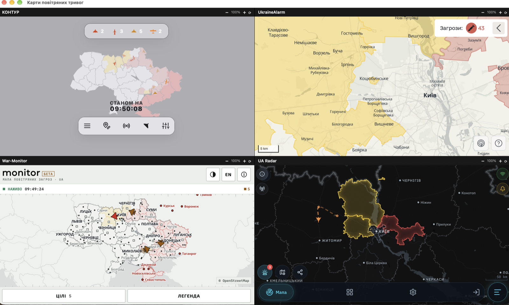

# AlertsGrid

Чотири карти повітряних тривог України в одному вікні, сіткою 2×2 — щоб не
тримати чотири окремих вкладки браузера.



Кожна карта відкривається як справжня браузерна сторінка (`WKWebView` на macOS,
`<webview>` в Electron), тож блокування вбудовування (`X-Frame-Options`,
CSP `frame-ancestors`) на них не діє — працюють усі чотири сайти.

## Карти

- [КОНТУР](https://kontur.systems/)
- [UkraineAlarm](https://map.ukrainealarm.com/)
- [War-Monitor](http://map.war-monitor.org)
- [UA Radar](https://www.ua-radar.online/)

## Можливості

- Сітка 2×2 в одному вікні
- Приховування зайвих банерів на картах (через впорскування CSS)
- Масштабування кожної карти (корисно на малих екранах): кнопки **− / +**,
  подвійний клік по назві — скинути, **Ctrl/Cmd + / − / 0** — на всі одразу;
  масштаб зберігається між запусками
- Оновлення карт: **⟳** на панелі або **Ctrl/Cmd + R** на всі
- Повний екран — **F11** (Electron)

## Платформи

| ОС | Технологія | Де код |
|----|-----------|--------|
| macOS | нативний Swift + WebKit | `AlertsGrid.swift`, `build.sh` |
| Windows 11 x64 | Electron | `electron/` |
| Raspberry Pi OS (64-bit) | Electron | `electron/` |

### macOS (нативний застосунок)

Потрібні лише Xcode Command Line Tools.

```bash
./build.sh          # збирає AlertsGrid.app
open AlertsGrid.app
```

Або запустити без збірки: `swift AlertsGrid.swift`.

### Windows та Raspberry Pi (Electron)

```bash
cd electron
npm install
npm start
```

Детальні інструкції для кожної платформи (включно зі збіркою `.exe`,
`AppImage`/`.deb` та автозапуском на Pi) — у **[electron/README.md](electron/README.md)**.

## Налаштування

Список карт і правила приховування банерів задаються масивом `MAPS`:
в `AlertsGrid.swift` (macOS) та `electron/renderer.js` (Electron).

## ⚠️ Застереження

Застосунок лише агрегує сторонні карти й **не замінює офіційні сповіщення про
повітряну тривогу**. Під час тривоги керуйтеся офіційними джерелами та прямуйте в укриття.
